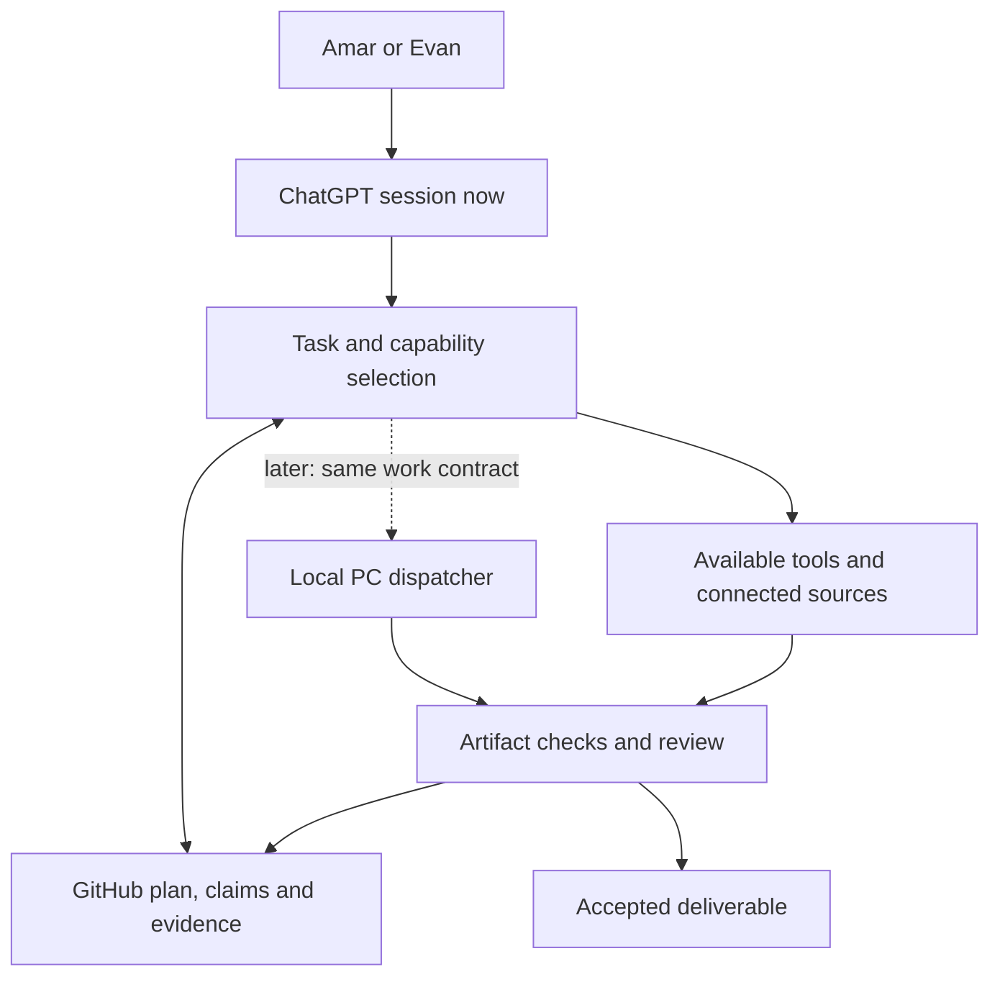

# Rovor AI — master plan

Decision date: 2026-10-21. Current operating mode: **ChatGPT-first, human-directed sessions**.
Future mode: selected workloads on Amar's own hardware, then verified unattended job types.
This is the canonical direction for both Amar's and Evan's sessions. It is a plan, not evidence that
all listed capabilities, connections, local models or background workers are installed.

## Updated hybrid inference and always-available workforce direction (Oct 23, 2026)

The owner has selected the Breaking Bad-named Walter-led roster with provider-specialized task routing: Gemini for planning/long context, Groq and NVIDIA NIM for fast repetitive tasks, Mistral for code/review, and checked free-only OpenRouter as fallback. Cloudflare Workers Cron + D1 is the **proposed** globally scheduled control/state plane while the existing Mac launchd/SQLite worker remains the only host executor for macOS apps and terminal. Read [architecture/HYBRID-24-7-GHOST-WORKFORCE.md](architecture/HYBRID-24-7-GHOST-WORKFORCE.md) and [coordination/ghost-provider-policy.json](coordination/ghost-provider-policy.json) for the source of truth. This updates provider preferences and cloud scheduling target **without claiming any provider key, cloud deployment, private Mac channel or unattended AI loop exists yet**. Default authorization is zero spend; on quotas/connection failure keep durable state and stop, not paid fallback or infinite retry.

## Mission and current decision

Build a practical Rovor Digital business assistant that can research, plan, create, test and coordinate
work across the agency. Video production is one capability among several. Use the present ChatGPT
session's strongest available tools now; do not wait for the PC or spend months building a replacement
chat interface before delivering useful work. Convert successful repeated workflows into reusable
instructions, templates, code, test cases and portable work packets.

GitHub is the versioned source of instructions, code, shared development ownership and evidence.
It is not the model, a shared live chat, a GPU, a credential store, or proof that either computer is online.
The long-term Rovor AI is a system of knowledge, tools and controlled workflows using replaceable models;
it does not require training a foundation model from scratch.

The new PC will eventually supply compute. Its final GPU, usable VRAM, RAM, storage, OS, drivers and
availability are unverified. Earlier hardware aspirations are not a capacity guarantee or purchase plan.
No hardware/model purchase or paid API subscription is required by this roadmap.

## What to do when the user says “work”

1. Read latest main `AGENTS.md`, `WORK.md`, this plan's current phase, the shared queue and routing.
2. Refresh the relevant PR/checkpoint and verify actual tools available in this session. Identify yourself
   with a stable session owner; do not impersonate another session or machine.
3. Continue your own eligible claim. Otherwise choose the highest-priority eligible task using WORK.md.
   Prefer a concrete client/business deliverable or a demonstrated blocker over speculative infrastructure.
4. Read only the selected capability's playbook, relevant source files and acceptance evidence. Use the
   available research, code execution, visual, document or connected-app tools that fit the deliverable.
5. Claim before implementation, preserve other owners and source work, verify the useful result, and
   publish an exact handoff. One session may finish several sequential bounded tasks; do not stop after
   an abstract plan when an authorized deliverable can be completed.

Read `architecture/CHATGPT-WORKFLOWS.md` for tool routing and the standard work packet.
`architecture/capabilities.json` maps abilities and maturity; it is NOT another task/ownership queue.
`coordination/tasks.json` remains authoritative for claims, dependencies and next actions.

## Capability map

| Ability | Useful business result now | First workflow and quality check | Later local equivalent |
| --- | --- | --- | --- |
| Operations and planning | Clear next tasks, blockers, handoffs and project status | Existing work router/report; inspect current evidence | Same reports plus durable local dispatcher |
| Research and strategy | Source-backed customer/business opportunity and focused plan | Evidence URL/date, observations separate from inference | Local model plus authorized search/retrieval tools |
| Sales preparation | Credible offer, proposal or follow-up draft | Use verified proof, scope and pricing; verify recipient before any requested send | Drafting adapter; separate authorized messaging connector |
| Client intake and delivery | Complete requirements, missing-input list and review packet | Existing templates; explicit acceptance criteria and version | Structured project records and deterministic checklists |
| Websites and conversion systems | Working landing page/site, forms and booking flow | Available Sites/code workflow, responsive preview and form/link tests | Local code worker, browser tests and approved deployment adapter |
| Brand and design | Consistent logos, graphics, layouts and campaign assets | Approved brand sources; use image/design tools with visual inspection | Suitable licensed image/design models and native editing tools |
| Writing and content strategy | Useful scripts, copy, content briefs and publishing-ready drafts | Source/fact check, brand voice, audience and objective | Local text models against the same acceptance examples |
| Video and audio | Source-faithful, entertaining approved video | Preserve existing engine branches, original narration and art; technical + visual QA | Existing renderer, alignment tools and verified Moho adapter |
| Documents and proposals | Usable PDFs, docs, presentations and reusable client material | Appropriate document tool/skill, render and inspect | Local generation/rendering libraries with same templates |
| Analytics and reporting | Understand inquiries, delivery time, rework and content results | Authorized data, correct formulas, sourced periods and unknowns | Local analysis, read-only data connectors and scheduled reports |
| Engineering and automation | Tested tools that remove repeated work | Focused code/CI, measured change, rollback and exact handoff | Local repository worker and bounded job executor |
| Knowledge and account support | Find current brand/client/project facts and draft accurate replies | Retrieval with source/version, tenant separation and unresolved facts | Local indexed source store and permission-aware retrieval |

These are capability goals. Availability is checked per session and per account; a tool exposed in Amar's
chat is not automatically exposed in Evan's. No promises of flawless work, guaranteed sales or studio
animation quality follow from choosing a role or model.

## Architecture: use the same workflows through changing executors

Separate the reasoning provider from execution. A model proposes a plan or structured tool call; a tool
validates inputs, permissions and scope, executes a supported action, and returns evidence. Retrieval
provides relevant source material. A checker verifies output. A review decision determines acceptance.
Do not make a single giant prompt responsible for durable ownership, money, process control and recovery.

## Phases and exit gates

### Phase A — ChatGPT-first operating system (current)

Use the shared plan and task queue immediately. Existing main already includes task/routing checks,
GitHub handoff reports, business templates and a fixed operations reporter. Main's hosted Actions jobs
recently failed before runner startup; that is an unresolved operational blocker, not a reason to stop
all local work or remove validation. Check live evidence before claiming it is repaired.

Next deliverables: a curated Rovor knowledge pack; a role/tool playbook proven on real tasks; a service
delivery playbook; truthful portfolio proof; and capability evaluation examples. Produce business work
alongside engineering. Do not add an unneeded framework just to make a directory diagram look complete.

Exit gate: a fresh authorized session can load the plan, select a nonconflicting task, create a useful
reviewable artifact, verify it and leave a handoff that another session can continue without guessing.
Demonstrate this across at least three different capability families, including one business deliverable.
This gate is proposed acceptance, not a claim it has already passed.

### Phase B — Repeatable tool workflows in ChatGPT

Standardize work packets and output manifests from proven Phase A examples. Create small reusable skills
or plugins only when repetition or a concrete missing connection justifies them. Reuse existing tools
before wrapping everything in a new plugin. Scope permissions to the actual needed service/action.

Exit gate: representative jobs have documented input requirements, measurable acceptance, artifact/version
references and failures that stop honestly. ChatGPT can run the workflow during an authorized session;
no API key, browser session or unattended execution is assumed from a ChatGPT subscription.

### Phase C — Hybrid execution on available computers

Only after actual machine access is verified, offload deterministic tasks such as file analysis,
rendering, encoding and tests to the appropriate existing machine. Keep ChatGPT as the working interface.
Amar's PC is not a prerequisite for contracts, tests, drafts, documentation or business work now.

Use one authenticated intake interface, host-owned capability adapters, explicit inputs and a receipt.
Extend the existing PR #13 native-Moho spool/adapter path when suitable; do not create a competing MP3
transport. Do not assume Windows hosts Mac-only Moho setup. Mac and Windows remain distinct endpoints.

Exit gate: run a real permitted job on the intended machine, retrieve a verified artifact, interrupt the
worker, recover safely, reject a duplicate job, and prove a source update cannot replace a running release.

### Phase D — Local model evaluation after the PC is ready

Inventory actual hardware and benchmark one local inference provider against the saved evaluation pack.
Begin with a compact text workload that benefits the business: structured intake extraction or draft
classification. Preserve ChatGPT execution as an available option; migrate per capability only when the
local output meets the same quality checks and is worthwhile in elapsed time, memory and total effort.

Candidate providers such as llama.cpp or Ollama stay behind an inference adapter. Do not hardcode a model
name, GPU SKU, context limit or performance promise now. Check current compatibility and model commercial
licenses at selection time. Brand knowledge comes first from curated retrieval, not premature fine-tuning.

Exit gate: actual machine/model/version, cold/warm latency, memory peak, output-quality score, failure rate,
and power/thermal behavior are recorded on Rovor examples. Demonstrate adequate headroom during real use.

### Phase E — Bounded ghost employees

Promote ONE verified job type at a time to event/scheduled execution. Start with a read-only report or
internal draft. A ghost employee is a persistent, monitored worker that can finish that defined job while
people are away; it is not merely a role description or a chat that says it will keep working.

Require durable claims/leases, heartbeats, restart behavior, budget/time limits, cancellation, artifact
receipts, audit records and an actual notification/review destination. Notification delivery is a separate
authorized action; do not promise a message without a configured sender/recipient and a delivery test.
For uncertain external effects, stop and reconcile instead of blind retry. No promise of exactly-once
external delivery without service-side idempotency/reconciliation.

Exit gate: a supervised soak run of the selected real job type, including disconnect, crash, timeout,
duplicate submission, missing asset, invalid approval, low disk and unavailable GPU scenarios; no data loss,
unauthorized effects or duplicate delivery. A broad autonomous workforce remains a future milestone.

## Portability rules to build now

- Use portable input/output manifests with capability/version, source references/hashes, objective,
  constraints, acceptance, expected artifacts, execution environment and evidence.
- Keep business prompts, templates, quality examples and source knowledge independent of model names.
- Record when a result depends on a ChatGPT-only tool, paid service or platform-specific program.
- Prefer deterministic code for arithmetic, file validation, hashes, image/video encoding and state changes.
  Use model judgment for interpretation, drafting and creative decisions, with appropriate verification.
- Keep private runtime state, credentials, client documents, model weights and bulk media out of Git by default.
  The separately authorized audio import retains its existing owner and permission; do not duplicate it.
- Do not rename or restructure `rovor-video-engine` to implement this plan. Add modular capability boundaries
  and interfaces around existing source. Split repositories only when deployment/access needs justify it.
- Preserve existing source art, original narration, reference branding and successful outputs. Separate technical
  pass, artistic/client approval, publication and delivery; no amount of green CI implies all four.

## Future local-PC design constraints (not implementation tasks yet)

Use a small single-host service first: a durable local job database, filesystem artifact store, model/tool
adapters and a review interface. SQLite is a reasonable initial metadata-store candidate, but its WAL file
must remain on the hosting machine. Other computers use an authenticated API, not a network-shared SQLite
file or Git/Dropbox synchronization of a live database. Add a distributed database only when justified.

GitHub's development task queue and the future runtime job store serve different purposes: the former
coordinates code changes, the latter records submitted production jobs. Never maintain competing ownership
records for the SAME task. A runtime job may reference its source revision/capability; it is not a code claim.

Start with one GPU-heavy job at a time. Model weights, context cache, image/video generation and rendering
compete for memory. Admit tasks according to measured resources, bounded context and model residency;
unload or queue workloads instead of launching every role simultaneously. Actual concurrency is benchmarked,
not inferred from a target VRAM figure. Local work has hardware, electricity, maintenance and license costs.

Use immutable release directories/commits, explicit activation, migrations with backup/rollback and tested
restore. Do not run unreviewed PR code as a personal-machine worker with broad filesystem credentials.
The existing working installation and active render should survive an update failure.

## Decisions, evidence and change control

Current decisions: ChatGPT-first; GitHub as shared versioned coordination; one development queue; reuse
existing engines; capability-specific workflows; local hardware later; no new subscriptions by default;
performance and business improvement claims require measured evidence.

Unresolved until needed: final PC/OS, local model/provider, authenticated remote access, business-system
connections, actual service/account limits, production asset locations, and individual unattended job scope.
Do not ask Amar to settle all of these now. Record the exact missing input only when it blocks a chosen task;
continue independent eligible work otherwise.

Update this plan when the user changes direction or an experiment disproves an assumption. Capture the
reason, source and affected tasks; preserve completed work and active scopes. A new chat must not silently
replace this roadmap with a second architecture or reset the project.

## Source notes

Repository status is authoritative through live task/PR evidence, not this dated narrative. This plan is our
engineering design. Technical candidates were checked against primary documentation on 2026-10-21:

- OpenAI: https://learn.chatgpt.com/docs/use-chatgpt and https://learn.chatgpt.com/docs/projects — task inputs,
  connected sources and tool availability vary by environment; verify actual access.
- OpenAI: https://learn.chatgpt.com/docs/agent-configuration/agents-md — durable repository instructions.
- llama.cpp: https://github.com/ggml-org/llama.cpp/blob/master/tools/server/README.md — local model serving
  behind an API is a candidate integration path, not an installed Rovor provider.
- SQLite: https://www.sqlite.org/wal.html — local-host WAL constraint.
- Ollama: https://github.com/ollama/ollama/blob/main/docs/faq.mdx — concurrency/context consume available memory.
