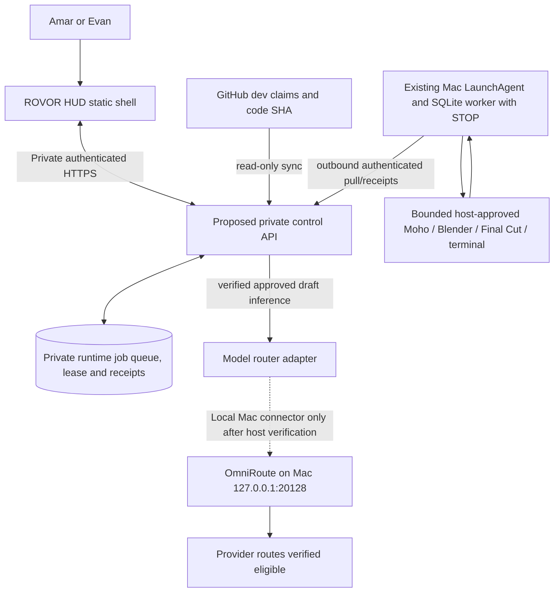

# ROVOR Workforce Control Center — product and architecture specification

> **Implementation update (2026-10-24):** The public source-only Workforce Control HUD prototype now exists at `dashboard/command-center/workforce/index.html`; see `WORKFORCE_HUD_IMPLEMENTATION_CHECKPOINT.md`. Worker heartbeat, private job queue, OmniRoute model inventory and approve/dispatch remain **unconnected**, not live.


**Status:** Proposed / not deployed. 2026-10-24. This document preserves an implementation direction for Amar and Evan; it is **not** an active cloud worker, proof of Mac access, model connection, spending approval, or authority to dispatch.

## North star

An Iron Man-inspired **but easy-to-use** ROVOR command center where Amar or Evan can write a goal in everyday language, inspect Walter's proposed steps, route approved work to ghost employees, monitor model usage and queues, and review useful completed results **without leaving the same visual HUD**.

**Core usability principle: simple on the surface, powerful on demand.** Nobody should need to understand API endpoints, provider quotas, task JSON, or Mac terminals to enqueue a draft/research job. Technical details are available one click deeper.

## Existing foundation (do not rebuild)

- `WORK.md`, `AGENTS.md`: active collaboration rules and source/evidence discipline.
- `coordination/tasks.json` and `coordination/work-routing.json`: authoritative development claims plus capability routing. **Do not** use these as a second runtime queue.
- `coordination/ghost-provider-policy.json`, `coordination/ghost-role-bootstrap.json` and `architecture/HYBRID-24-7-GHOST-WORKFORCE.md`: model restrictions, eight employee identities, review gates and proposed cloud coordination.
- `tools/omniroute_reasoning_admission.py`, `tools/omniroute_dispatch_permit.py`: fail-closed offline model candidate checks. They do **not** call the gateway or enqueue anything.
- Existing Mac LaunchAgent, SQLite worker, STOP and private Mac bridge / PR #41 candidate. Reuse, validate and extend them rather than creating a second scheduler.
- `dashboard/command-center/native/index.html`: real interactive home HUD with Earth, responsive layouts, six mini panels. Preserve `/exact/` rollback and `design/hud/RESPONSIVE_LAYOUT_REFERENCE_v8_2.md`.

**Status honesty:** Mac OmniRoute availability and actual ~nine model routes must be read from the Mac when authorized; a localhost tab or GitHub source is not sufficient. Cloudflare Cron+D1 is presently **architecture only**, not a running control plane. The GitHub Pages shell is a static frontend and must not hold private provider keys or execute privileged commands.

## User journey — 20 seconds to propose a job

1. Open HUD → **New Job**. One text field: “What do you want done?” Examples: “Research Moho mouth shapes for Jesse,” “Check the latest repo tests,” “Prepare three social video concepts.” Optional drop-downs: specialist / deadline / deliverable.
2. Walter creates a **draft plan**, not an automatically dispatched job. Plain summary: “Jesse will prepare a 2D lip-sync checklist. Estimated model use: verified $0 route only. No file edits or posting.”
3. Show **Approve & queue** only after the private backend has authenticated the user, checked the permitted operation, available host capabilities, deduplication, STOP, source privacy, current cost, and fresh model quota. Without these checks: **Save Draft** or **Review Required**. Different permissions for Amar (owner) and Evan (approved teammate) must be explicit, never inferred from GitHub identity alone.
4. Mini window immediately shows the queued job and then its **real status**: waiting / assigned / running / needs review / blocked / complete. When Mac is offline, show “Waiting for Mac connection” instead of “Worker running.”
5. Completed work opens in a **HUD-styled review window** with an artifact preview, validation evidence, source SHA, acceptance checks and actions: Accept / Request changes / Archive.
6. Notification and repeat schedules are **opt-in**. Never auto-publish to social media, email clients, make purchases, edit native libraries or run arbitrary shell commands.

### Plain-language first, advanced details second

- “Waiting for available model” rather than “HTTP 429”; expanded technical detail can show provider, exact model ID, retry-after and receipt.
- “Not connected” rather than a fake 99% system health ring; every state has last verified time and source.
- A green/blue bright dot only signifies **verified** connectivity; current theme favors blue/ice white, no green accents.
- “No extra cost verified” only when billing terms and live quota were actually checked; no inferred free credit.
- Clear progress: **3 of 5 steps complete** only if persisted steps exist; do not manufacture progress from elapsed time.
- One obvious back/close action; keyboard Esc, swipe/wheel inside compact card, focus-trapped modal, 44px touch targets.
- Three viewing levels: compact HUD card / HUD-themed expanded module / advanced detail sheet. Never replace a cinematic module with a generic webpage.

## Modules for the existing cockpit

| Instrument | Mini scroll window on home screen | Expanded same-design view |
|---|---|---|
| **Job Queue** (Active Tasks) | Recent draft/queued/running jobs with role and state, scroll cue | Search/filter, job plan, priority, dependencies, approve/hold/cancel controls with permission gate |
| **AI Fleet** (System Health) | Walter, Mike, Jane, Jesse, Gale, Gus, Saul and Hank; real last-seen and active job | Role charter, allowed tools, capabilities, latest receipt, blockers, quality history |
| **Model Router** (API Quota) | Available verified model count, one selected route, quota timestamp | OmniRoute provider/model explorer, exact IDs, caps, supported actions, error rate, route preferences, paid fallback forbidden by default |
| **Mission Timeline** (Recent Activity) | Last state transitions with timestamps | Per-job attempts, leases, source revision, artifacts, QA outcomes and failures |
| **Production Vault** (Live Feed) | Most recent actual preview: video / image / docs / code | Media/assets with version hashes, approval status, source provenance and delivery links |
| **Machine & Cost** (Resource Usage) | Mac online/offline, last heartbeat, provider requests, verified budget | Machine capability matrix, STOP state, daily/weekly usage, $0 gate, alert and troubleshooting explanations |

Navigation can present DASHBOARD / JOBS / EMPLOYEES / MODELS / RESULTS, with GITHUB and SETTINGS in a utility menu. Preserve original mobile portrait and iPad/desktop landscape layouts; do not create a second frontend.

## Trusted architecture



**Critical distinction:** Static GitHub Pages cannot safely communicate directly with Mac localhost or expose model API tokens in public JS. For remote devices use authenticated, scoped backend HTTPS and a *Mac-initiated outbound* poll/receipt mechanism. D1/Cloudflare is a candidate, not an assumed provisioned service. The current locally installed proxy and its accounts must be tested on the Mac before promising any model inventory.

- GitHub stays the development and versioned source of truth; don't continuously commit private runtime log lines/PII as task updates.
- Private runtime DB owns job IDs, idempotency, claims/leases, provider attempts, cost receipts, last heartbeats and approvals.
- Model **provider is not employee identity**: Walter is the supervisor; Mike (Mac), Jane (Final Cut), Jesse (Moho), Gale (Blender), Gus (operations), Saul (marketing), Hank (QA) hold capabilities; routing may select an eligible different model per job.
- Model eligibility $0 by default, current terms/quotas checked, explicit human authorization for external data and spending. Use existing candidate-only OmniRoute admission utilities as one guard, not an execution permit.
- Preserve original STOP, five-claims-per-rolling-24-hours OmniRoute restriction until explicitly revised. Atomic lease/recheck at runtime prevents duplicates. Any uncertain side effect requires manual review; do not auto-retry.
- Store credentials in Mac Keychain/private server secrets; expose only sanitized IDs, freshness and aggregate metrics to HUD. Keep auditable access controls, CSRF protection, session expiry, rate limiting and a clear logout.

## Compact data contracts (proposal only)

Public-safe status summary, delivered by private authenticated API:

```json
{
  "schema_version": 1,
  "snapshot_at": "ISO-8601 UTC",
  "source": "mac_heartbeat_or_private_controller",
  "worker": {"id": "jane", "connection": "offline", "last_seen_at": null, "current_job_id": null},
  "model": {"provider": "unverified", "model_id": null, "eligibility": "not_verified", "remaining_quota": null},
  "runtime_job": {"id": "job_...", "type": "research_draft", "state": "waiting", "steps_total": null, "steps_done": null, "receipt_ref": null},
  "safety": {"stop_present": true, "dispatch_allowed": false, "cost_usd_verified": null}
}
```

Unknowns remain `null`, never zero or “online.” Backend must sign/authenticate source reports and check monotonic timestamp/lease semantics; displayed receipt links should resolve to authorized user-visible redacted evidence.

State flow:

`draft → needs_approval → queued → leased → running → needs_review | completed | blocked | cancelled`

Transitions are server-validated; “Pause” can prevent further steps but cannot guarantee immediate interruption of a GUI operation. A separate verified emergency STOP must remain visible and be tested on the real host.

## Design principles for usability and visual quality

- **One prominent primary action:** NEW JOB. Secondary: Review Queue. Tertiary: Advanced Controls.
- **Always show why:** no mysterious gray disconnected dots; error/review panels explain the required next action.
- **Consistency:** tiny scroll cards have sticky headings, bottom scroll hint only when overflowing, same angular borders/font/glow as expanded panels. Never full-page generic white/modals.
- **Touch:** thumb-accessible bottom dock, iPhone safe areas, swipe within cards, 44px hit areas; iPad landscape three columns.
- **Accessibility:** visible focus, screen reader labels, meaningful text states, reduced motion, sufficient contrast, no color-only status.
- **Responsive density:** desktop shows six instruments + reactor; phone prioritizes “New Job / Queue / Alerts” above details. Details are one tap deeper, never discarded.
- **Validation:** demo using synthetic **clearly labeled sample** status only in a demo mode; production default unverified until source evidence arrives. Test stale/offline, 100+ tasks, queue scrolls and refresh-preserved positions.

## Phased implementation with measurable exit criteria

| Phase | What to build | Do not claim until |
|---|---|---|
| **0 — Current** | Versioned design spec, personas, wire contracts and safety gates in GitHub | Proposed only |
| **1 — Read-only UI** | One **Employees / Models / Jobs** HUD module using sanitized real GitHub/host receipt snapshots, source-timestamped | UI browser QA on phone/iPad/desktop and real source values |
| **2 — OmniRoute inventory** | Private Mac-local, read-only health and model inventory adapter; persist latest sanitized snapshot, show exact model IDs/eligibility | Authenticated Mac-origin `/v1/models`, provider eligibility, no secrets leaked |
| **3 — Draft jobs** | New Job composer, bounded typed schema, dedupe key, review status, no execution | Server authorization, validation, audit and review demonstrated |
| **4 — Private runtime backend** | Authenticated HTTPS control plane + durable private job records + receipts; Cloudflare Cron/D1 only with explicit account approval | Two separate scheduler wakes, restart continuity, budget and STOP enforcement |
| **5 — Bounded execution** | Reuse existing Mac SQLite worker with outbound pull and approved operation allowlist, no arbitrary instruction-to-command conversion | Real Mac host receipts, duplicate rejection, crash/restart tests and manual STOP |
| **6 — Production modules** | File/website/video work result previews, QA and approval workflows, optional notifications | E2E job produces a verified useful deliverable with approved quality |

**Immediate first implementation recommendation:** Build **read-only AI Fleet + Model Registry + Job Queue** inside the current native HUD using existing scoped data contracts and honest `unverified` states. This adds practical value without another hidden worker, paid provider call, remote-control exposure, or a second scheduler. Then implement a private OmniRoute inventory bridge on the actual Mac.

## Five user-facing acceptance tests

1. On iPhone: “New Job” opens a friendly one-field composer and saves a **draft** without dispatch.
2. On desktop: every mini panel scrolls with 20+ records; expanded view retains original HUD visual style, home stays visible behind.
3. With Mac offline: employee reads “Waiting for Mac” / “Last seen” and queue remains durable, with no false success status.
4. With zero verified free provider quota: Approve cannot dispatch; model picker explains why.
5. With an actual completed review-only job: artifact+receipt appear in Results, marked “Ready for review” until Amar accepts it.

**Related:** [Hybrid workforce architecture](../../architecture/HYBRID-24-7-GHOST-WORKFORCE.md), [Provider policy](../../coordination/ghost-provider-policy.json), [Roles](../../coordination/ghost-role-bootstrap.json), [HUD responsive baseline](RESPONSIVE_LAYOUT_REFERENCE_v8_2.md).
